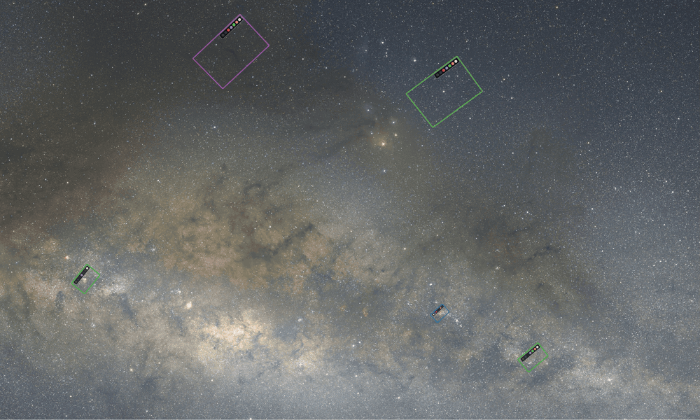
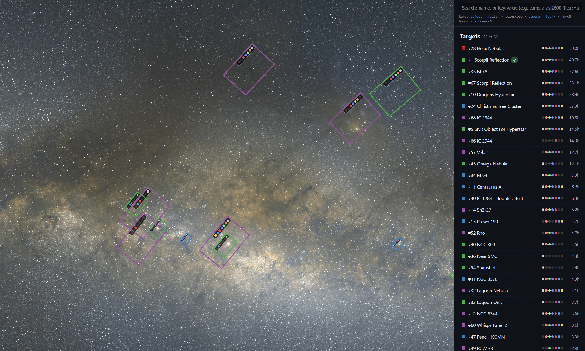
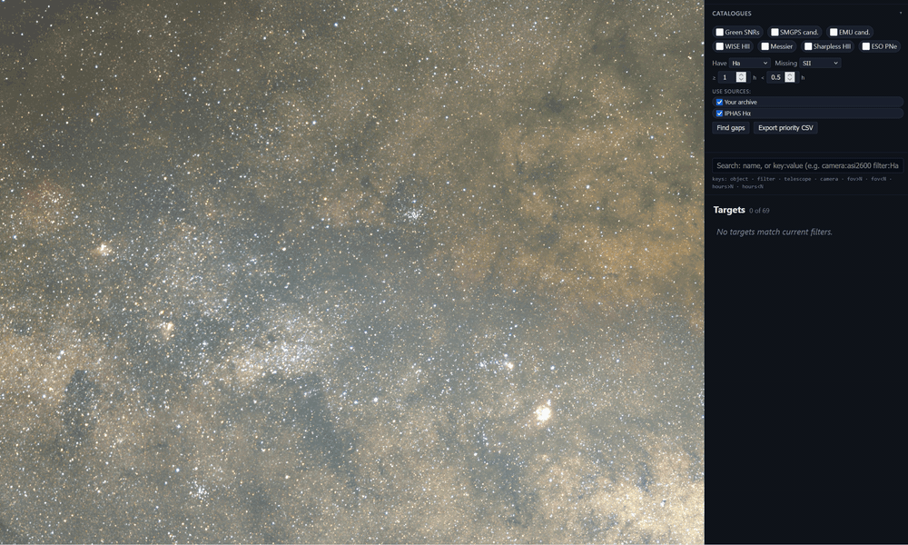
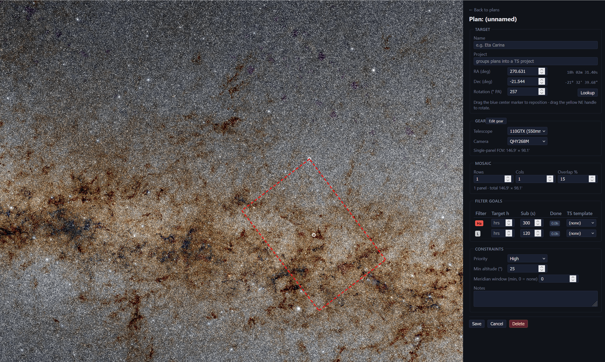

# Astro Coverage Planner

**See what you've already imaged. Plan what's next. Hand it to NINA.**

https://github.com/user-attachments/assets/40cbe54b-40c5-47ed-baac-2224e370d5b9

It's your astrophotography catalogue, visualised. ACP reads your entire FITS library and draws every field you've ever shot onto one sky map — coloured by telescope, badged by filter, with integration hours on every target. Useful from your first handful of targets and only gets more valuable as your library grows, especially if you're shooting narrowband or multi-night projects and want to see at a glance which targets are finished, which still owe you an OIII pass, and where your different rigs overlap. Plan your next session, next month, or next whole *year* in the same view — and export it straight to NINA Target Scheduler.

## Who this is for

ACP is built around a few specific imaging patterns. You'll get the most out of it if any of these sound like you:

- You shoot **with filters** (narrowband, LRGB, mixed) and want to see which targets are missing which channel.
- You build up integration **across multiple nights or multiple sessions** and want a clear picture of which projects are actually finished vs. half-done.
- You use **multiple telescopes** and want each rig's footprints visually distinguished on the same sky map (colour-coded, with filter badges per polygon).
- You plan sessions with **mosaics** and want the panel layout, rotation, and per-filter exposure goals captured in one place — and synced to NINA Target Scheduler so you don't re-enter targets manually.
- You want **one place** to answer "what have I shot, where are the gaps, what's next" without juggling spreadsheets or scrolling through folders.

You don't need a huge library for this to start paying off — even a couple of dozen targets is enough to surface projects you'd half-forgotten about. Most people wish they'd started this kind of catalogue years earlier.

## See it in action

Four moments that show what this is actually like to use.

### Your coverage on every sky survey

Same FOV polygons, same telescope colours — flip the background between optical, narrowband Hα, infrared, and radio surveys with one click. Hunting bright Hα regions you haven't shot? Switch to the Hα survey and scan for big patches with no polygons on them. Curious how a region looks in radio? One dropdown and you're there. ACP exposes Aladin Lite's full survey catalogue, so you've got dozens of professional astronomy datasets behind your map at all times.

### Smart search across your archive

The right-rail search supports a small grammar that combines with AND. Bare words match object names; everything else is `key:value`.

All search tokens

| Token | Effect |
|---|---|
| `eta carinae` | substring match across object names |
| `"north america"` | quoted phrases preserve spaces |
| `object:M42` / `name:rosette` | restrict to object/target name |
| `filter:Ha` | only targets with Hα data |
| `telescope:RedCat` / `tel:edge` | by telescope (fuzzy) |
| `camera:2600MM` / `cam:294` | by camera |
| `hours>5` / `hours<2` | total integration hours |
| `fov>60` / `fov<10` | FOV size in arcmin |

Use it for things like `filter:Ha -filter:SII tel:redcat` ("RedCat-shot Hα targets without SII") or `hours>5 fov<60` ("targets I've put serious time into with a tight rig"). The filtered list updates live as you type.

### Catalogue overlays for finding new targets

Toggle the Green 2019 SNR catalogue, SMGPS SNR candidates, WISE HII regions, the Messier and Sharpless lists, and ESO's planetary nebulae. Each one lights up its objects as markers across the sky. Combined with the survey-background swap above, you can pick a catalogue (say, confirmed SNRs), switch to the Hα survey, and scan for objects with bright emission you haven't shot yet — that's your shortlist for the next dark night.

### Plan your next session in the same map

Switch to **Planning mode** in the topbar. Click the sky to drop a target centre, pick telescope + camera (FOV box auto-derives from your gear), then build the goals as an ordered list of filter rows: each row is a filter, an exposure template (which sets the sub length) and an hours goal. Drag rows to reorder them and set how often the filter switches. Doing a mosaic? Set rows × columns × overlap %, drag the rotation handle to align the panel grid. Solid borders mean data already logged; dashed borders mean not yet started. When the plan's ready, the NINA plugin (below) can send it to NINA Target Scheduler so you're not re-typing targets.

## Get it running

### Windows: download and run

The simplest way on Windows, with no Python or terminal. Extract it to a short place such as `C:\` (giving `C:\ACP`), because Windows struggles with long paths. [Download ACP-windows-x64.zip](https://github.com/astro-roro/Astro-Coverage-Planner/releases/latest/download/ACP-windows-x64.zip) (not the "Source code" files the release page also lists), right-click it, choose Properties and tick **Unblock**, extract it and double-click `Start ACP.bat`. Extraction takes several minutes. If Windows shows "Windows protected your PC", click **More info**, then **Run anyway**.

ACP offers a Start menu and desktop shortcut the first time, then lives in the notification area (Windows 11 may hide the icon behind the ^ arrow). **Quit ACP** in the icon's menu stops it. The NINA plugin's address is `http://127.0.0.1:5555`, and this build can only be reached from the computer it runs on. [The install guide](docs/install.md#windows-download-and-run) has the details.

### From source

You need **Python 3.10+** and **git** installed. If you don't have them yet, follow the [zero-to-hero install guide](docs/install.md) first — separate Windows, macOS, and Linux walkthroughs included.

Once they're there, anywhere with a terminal:

    git clone https://github.com/astro-roro/Astro-Coverage-Planner.git
    cd Astro-Coverage-Planner
    python3 -m venv .venv                # Windows: python -m venv .venv
    source .venv/bin/activate            # Windows: .venv\Scripts\activate
    pip install -r requirements.txt
    python3 app.py                       # Windows: python app.py

(macOS and most Linux distros only ship `python3`, not a bare `python`: that's why the commands above are split. Windows is the other way round.)

Open <http://127.0.0.1:5555/> in your browser. The first thing you'll see is an empty sky map with a banner pointing you at step two: scan your archive.

**Step two: point ACP at your FITS library.** A fresh install opens the setup page by itself (it is also the **Settings** link in the header, at `/setup`). Paste the full path of your image folder, press **Add**, then **Scan my images**. When the scan finishes the map fills in. No environment variables or terminal commands are needed. [Setting up your own archive](docs/setup-archive.md) covers multiple image folders, the command-line builder, configuration variables, and the optional pipeline-DB integration for sub-exposure hours.

> **Just want to look around first?** Run `python3 scripts/make_demo_manifest.py` (Windows: `python scripts/make_demo_manifest.py`) to load five well-known targets as sample data (M 42, M 31, Eta Carinae, M 45, M 8 — spanning both hemispheres), then refresh.

### Running it in Docker

A prebuilt image is published to `ghcr.io/astro-roro/astro-coverage-planner:latest` on every merge to `main`. Mount your FITS library and a data volume, then run:

    docker run -p 127.0.0.1:5555:5555 \
      -v /path/to/your/fits:/fits:ro \
      -v acp-data:/app/data \
      ghcr.io/astro-roro/astro-coverage-planner:latest

Bind the port mapping to `127.0.0.1` like the example above unless you actually want the app reachable from other machines on your network. The container listens on `0.0.0.0` inside itself (so Docker's port mapping works at all), and ACP has no authentication of its own. Change it to `-p 5555:5555` only if you deliberately want LAN access.

The container runs as an unprivileged user (uid 10001) rather than root. A named volume like the example above just works. If you bind-mount a host directory at `/app/data` instead, that directory has to be writable by uid 10001, so on Linux you may need `chown -R 10001 /your/data/dir` once.

### Companion NINA plugin

The official **[ACP NINA plugin](https://github.com/astro-roro/ACP.NINA.Plugin)** brings the planner directly into NINA. It adds a dock panel in the Imaging tab that lists every plan from your running ACP instance, with a one-click **Push to Framing** button that loads the target into NINA's Framing Wizard: coordinates, rotation, mosaic geometry, camera dimensions and focal length all set automatically. From there you save the framing as a sequencer target and image it however you like (Simple Sequencer, Advanced Sequencer, manual capture). **No Target Scheduler required.**

For users who do use Target Scheduler, the plugin writes your plans into the TS database for the active NINA profile with **Sync All to TS**, or **Sync for tonight** for just the plans your connected rig can shoot. No zip imports, no faff. While you image, the plugin reports the frames it captured back to ACP, so your hours and goals update without any extra setup.

**Installing:** plugin 3.3 is on NINA's Stable plugin channel. In NINA, open Options → Plugins → Available, find **ACP** and install it, then point it at your ACP address (and the API token, if you have turned one on).

ACP itself still runs on Windows, macOS, and Linux — the plugin is the NINA-side layer (and NINA is Windows-only). If you image from Mac or Linux but have a Windows box driving NINA, that works too: run ACP wherever you like, install the plugin on the Windows side.

(Future plugins could push to Voyager, SGP, or other planners — the extension hooks are there.)

### Built in: sending your Target Scheduler setup to ACP

The plugin's **Send TS to ACP** button sends a copy of your Target Scheduler database to ACP, which shows what would change on a review page before anything is applied. Nothing changes in Target Scheduler, and nothing changes in ACP until you click Apply. ACP serves that page itself, from an extension that ships inside it (`bundled_extensions/nina_ts_sync`) and is switched on by default, so there is nothing to install. The Docker image includes it too.

Two things to set up:

1. Set `ACP_API_TOKEN` to a long random string before starting ACP. The extension refuses uploads until a token is set.
2. Enter the same token in the plugin's settings.

To turn it off, set `ACP_DISABLE_BUNDLED_EXTENSIONS=1` and restart ACP. ACP and the plugin keep working as described above, and you lose only the Target Scheduler to ACP direction. If you already have your own copy of `nina_ts_sync` in your extensions folder, that copy runs and the built-in one steps aside. More on how extensions load is in [the extensions guide](docs/extensions.md#where-extensions-go).

## Getting started in the app

The first time you open ACP, a short tour points out the map, the side panels, Planning, Time-aware and NINA sync. Skip it whenever you like. The Help button at the bottom of the right-hand rail, or the ? key, opens a list of what ACP can do and where each thing lives, the mouse and keyboard shortcuts that nothing else on screen mentions, and a Take the tour button to run it again.

## Other things it does

The headline features are above. These are the secondary bits — the stuff that makes day-to-day use comfortable without needing to be the centrepiece.

### On the map
- **Four projections** — Aitoff, Mollweide, Orthographic, Gnomonic. Switch with one click; everything redraws live.
- **Equatorial or Galactic** coordinate frames.
- **Click any FOV polygon** for the full target detail — per-filter coverage breakdown, integration hours, gear used, master files behind it.
- **Horizon overlay** — translucent bands marking the never-up declination at your active site (red) and the below-minimum-altitude band (amber).

### Filtering and finding
- **Per-filter toggles** for Hα, SII, OIII, L, R, G, B (and any other filter ACP found in your headers — IDAS / IR / Astrodon variants surface automatically).
- **Logic modes**: ANY (matches any selected filter), ALL (matches every selected filter), or "have Hα but NOT SII" gap-finder logic.
- **Depth slider** — hide targets below a minimum hours-per-filter threshold (0–10h). Handy for filtering out the ones you've barely scratched.
- **Cross-source gap-finder** — pick a "have" filter and a "missing" filter, set hour thresholds, and ACP highlights every region of sky where one is covered but the other isn't, with public-catalogue candidates scattered inside the gap.
- **Saved searches** — name a combination of filter / priority / category settings and recall it later from a dropdown.

### Site and observability
- **Sites manager** — add, edit, and switch between observing locations (lat / lon / altitude / minimum-altitude threshold). Active site persists across reloads.
- **Live altitude status bar** showing how many targets are currently above 30° / 60° at your active site.
- **Time-aware mode** — toggle on to see what's observable across the night, not just right now. Adds:
  - **12-month visibility sparklines** on every target row (great / good / fair / partial / not visible per month).
  - **Now / Trend chips** — "Now: Good · ↑ Improving" or "Peaks in 4 months" when current conditions are bad.
  - **Sort options**: number, hours, name, best this month, best tonight, best upcoming.

### Planning depth
- **Gear auto-seed** — first time you open Planning mode, ACP scans your manifest and imports every telescope and camera it found, including focal length, aperture, pixel size, sensor size, and the filters each rig has used. Tweak in the gear editor; re-run "Scan coverage" after rebuilding the manifest.
- **Exposure templates** — the gear editor holds several templates per camera filter, with one starred as the default for new plan rows. The filter wheel comes from your NINA profile, as the plugin reports it. Each plan row picks a template, and ACP pushes the templates to Target Scheduler through the plugin, so plans use *your* templates rather than auto-generated ones.
- **Mosaic geometry** — rows × columns × overlap %, with a draggable rotation handle. Default 15% overlap is the sweet spot for gradient blending. Panels labelled by row/column (e.g. `Panel 3 (R1C2)`).

### Sharing and external data
- **Friend manifests** — load sanitised coverage manifests from imaging buddies as toggleable layers, so you can split the sky between you and avoid duplicating Hα hours on the same target. See [the sharing guide](docs/sharing.md).
- **Public survey coverage overlays** — toggle MOC footprints from CDS-hosted surveys (IPHAS DR2 Hα ships in the box; more easy to add) to see where professional surveys have already covered the sky alongside your own work. See [the public-survey docs](docs/public-surveys.md).
- **Plugin platform** — extensions can register custom coverage sources, ranked tile inventories, class-tagged catalogues, or UI actions (buttons + toggles in the planning rail, including swapping a core button for an extension-supplied one) and they show up alongside the built-ins. See [the extensions guide](docs/extensions.md) for the protocols and the manifest API.

### Export
- **CSV export** of priority candidates (e.g. Hα ≥ 1h, SII < 0.5h) — paste into NINA or whatever you keep your target list in. This needs both your manifest and the catalogue overlays built first, so press **Download catalogues** on the Settings page, or run `python scripts/fetch_catalogs.py` (see [Setting up your own archive](docs/setup-archive.md#optional-download-catalogue-overlays)) before using it: without that, the export endpoint returns an error.

## Want to dig deeper?

ACP is designed to be hackable, with a stable API surface and three plugin protocols. The full developer documentation lives in [`docs/`](docs/):

- **[Installing on Windows / macOS / Linux](docs/install.md)** — zero-to-hero per-OS walkthroughs.
- **[Setting up your own archive](docs/setup-archive.md)** — manifest builder, configuration variables, optional pipeline-DB integration, security and deployment notes.
- **[API and manifest reference](docs/api.md)** — every endpoint, the manifest JSON schema, gap-finder details.
- **[Extensions](docs/extensions.md)** — write Python plugins that register coverage sources, tile inventories, or catalogues against the protocols in `sources.py`.
- **[Sharing coverage with friends](docs/sharing.md)** — sanitised friend manifests as additional coverage layers.
- **[Public survey overlays](docs/public-surveys.md)** — wiring more CDS-hosted surveys into the Sources rail.

## Built with AI assistance

ACP was built with help from AI as a coding collaborator, it was used deliberately to ship faster and bring my vision to life.

Every change was driven by an actual astrophotographer using the tool on a real archive, reviewed line-by-line, exercised in the browser, and tested against a live FITS library + a live NINA Target Scheduler DB before landing. Real care and engineering effort went into making sure this isn't vibe-coded slop:

- **UI polish and consistency:** Filter ordering, colour vocabulary, keyboard affordances, accordion state, projection behaviour, and rail layout were all iterated on in the actual browser, not just generated.
- **Performance:** Regressions were profiled and fixed as they surfaced, not left for "later". Hot paths (manifest load, polygon redraw, MOC overlays) got specific attention.
- **Security review:** Public-facing endpoints, file handling, and query parameters were audited for the OWASP-style failure modes (path traversal, injection, unbounded responses).
- **Architecture decisions:** Protocol boundaries (coverage sources, tile inventories, catalogues, extensions, UI actions) were designed deliberately for future extensibility, with a documented plugin API and manifest contract so others can build against it.
- **No speculative code:** Features that didn't earn their keep got deleted. No half-finished scaffolding, no "AI added this just in case" branches.

If you find a sharp edge, that's on me, not the model. PRs and issues welcome. :)

## Dependency security

Hygiene for the supply chain is automated end-to-end:

- **Dependabot** monitors both the Python dependencies (`requirements.txt`) and the GitHub Actions versions referenced in workflows, opening weekly update PRs.
- **Minor and patch updates auto-merge** once the test workflow passes — small bumps land without manual intervention. Major version updates stay as separate PRs for me to review by hand.
- **Every update is tested before merge.** The test suite runs on every push and every PR via [`tests.yml`](.github/workflows/tests.yml); the container build in [`publish.yml`](.github/workflows/publish.yml) is gated on it passing, so a broken commit can't make it into the published image.
- **The Docker base image is pinned** to a specific Python version (see `Dockerfile`) — no `python:latest`.
- **CodeQL** runs on every push to `main` and weekly on a schedule, with the `security-and-quality` query suite.
- **Vulnerability reports** go through GitHub's [Private Vulnerability Reporting](https://github.com/astro-roro/Astro-Coverage-Planner/security) on the Security tab — see [`SECURITY.md`](SECURITY.md) for the full process.

## License

MIT, see `LICENSE`. The bundled Target Scheduler sync extension (`bundled_extensions/nina_ts_sync`) is by the same owner under the same licence.
